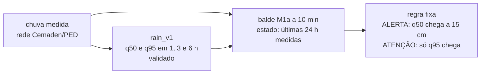

# Alerta de alagamento por regressão: relatório

Data: 2026-11-21 · Versão `flood_reg_v1` · `projeto-mapi-ai`, branch `feat/alerta-regressao`.
Reprodução: `scripts/reproduzir_regressao.sh`. Ele confere o SHA-256 de um dia de teste com `reports/regressao/reproducao.json` (`ab39332f…`) e sai com erro se o resultado mudar.

## 1. O que a rota entrega e o que não entrega

`POST /v1/flood/forecast` segue um único caminho:

- **Entrega:** a lâmina prevista (q50 e q95), em cm, por horizonte, e o nível (`ALERTA`, `ATENCAO`, `SEM_ALERTA`, `SEM_DADO` com motivo). Entrega também a validade, as versões, o commit e a atribuição `DADOS DA REDE OBSERVACIONAL DO CEMADEN/MCTIC`. A explicação traz o SHAP local do rain_v1, o contrafactual, a sensibilidade e a decomposição do balde a cada 10 min.
- **Não entrega:** probabilidade de alagamento. Nenhum modelo é treinado com rótulo de alagamento, sintético ou real (teste `test_nenhum_modelo_usado_e_treinado_com_rotulo_sintetico`). A rota antiga `/v1/predict/flood` (`logreg_v3`, rótulo sintético) saiu do serviço em 21/11 (commit `864ba40`).
- **Premissas declaradas** (`mapi_ai/flood/config.py`), fixadas antes do teste:
  - o acumulado previsto é espalhado por igual nos passos do horizonte;
  - a lâmina máxima de cada horizonte inclui a lâmina de agora;
  - uma lacuna na série medida vira `SEM_DADO`, nunca zero.

## 2. Validação (Etapa 2)

Fonte de todos os números: `reports/regressao/validacao.json` (gerado por `python -m mapi_ai.flood.validate`).

O método reconstrói o alerta a cada 10 min, de 2021-09 a 2026-10, nos 4 pontos com terreno. Jaboatão fica de fora, porque não tem terreno. A reconstrução usa os artefatos servidos do rain_v1, sem retreino, e o balde vetorizado, conferido contra o balde do serviço (teste `test_balde_vetorizado_da_validacao_igual_ao_simular`).

| Item | Resultado | IC 95% |
|---|---|---|
| 2.1 Cobertura dos quantis do rain_v1 no teste (nominal 50 / 80 / 95%) | 1 h: 83,7 / 89,7 / 96,4%; 3 h: 75,2 / 88,1 / 97,1%; 6 h: 68,5 / 88,6 / 97,0%. O q50 cobre mais do que o nominal (provável causa: muitos instantes com chuva real zero e mediana prevista acima de zero; `[não medido]`) | (fonte: `reports/v4/rain/evaluation.json`) |
| 2.2 Eventos FORTE do teste em que o balde, com a chuva **medida**, chega a 15 cm | **0 de 17** (10 dias; 11 dos 28 eventos são em ponto sem terreno ou sem série) | 0–31% (exato, por dia) |
| 2.3 Ponto-dias da Defesa Civil (2 km) com ALERTA ou ATENÇÃO | **0 de 41** (0 de 12 dias; 4 ponto-dias sem cálculo) | 0–26% (exato, por dia) |
| 2.3 Falsos alertas por ponto-mês | **0** (106,7 ponto-meses) | 0–0 |
| 2.4 Baseline "nunca alerta" | 0 de 41; 0 falso | 0–26% |
| 2.4 Baseline "chuva medida 6 h ≥ 25 mm" | **41 de 41**; **3,77** falsos por ponto-mês | 74–100%; 3,36–4,17 |

Notas:

- **O alerta por regressão nunca disparou em 5 anos, em nenhum dos 4 pontos.** No 2.3 ele empata com "nunca alerta" e não vence o segundo baseline. Esse é o resultado.
- **O IC é largo e precisa ter o mesmo destaque do número.** Com 12 dias, uma sensibilidade de 0% é compatível com até 26%. O bootstrap por dia degenera em [0, 0] quando há zero acertos, por isso o relatório usa o IC exato de Clopper-Pearson com o dia como unidade.
- **A chuva prevista nos dias da Defesa Civil está dentro da amostra.** Os dias são de 2021-05 a 2024-06, período de treino do rain_v1 (treino até 2024-07). Por isso a previsão de chuva nesses dias é otimista. Mesmo assim, o alerta não disparou.
- O critério do 2.3 foi aprovado pelo Lucas em 21/11, antes de olhar o resultado. O teste foi lido uma vez. Antes, uma execução quebrou com um erro de fuso na comparação de datas do 2.2; corrigido o erro, rodou de novo sem mudar nenhum critério.

## 3. O que a explicabilidade mostra (exemplo real)

CIN_UFPE, 2026-05-05 05:50 UTC, o instante calculável de maior chuva medida em 60 min no teste: 49,2 mm (fonte: `reports/regressao/exemplo_explicacao.json`).

- **Nível:** `SEM_ALERTA`. Chuva prevista em 1 h de 16,8 mm (q50) a 34,8 mm (q95). Lâmina de 0 cm nos dois cenários.
- **O que mais pesou na chuva prevista** (SHAP local, TreeSHAP exato):
  - chuva média nas estações a 5–15 km na última hora: 15,3 mm (+6,9 mm na previsão);
  - chuva no ponto nas últimas 3 h: 50,6 mm (+5,2 mm);
  - chuva no ponto nos últimos 10 min: 8,1 mm (+4,6 mm).
- **Contrafactual:** seriam precisos mais **109,3 mm** de chuva na próxima hora para a lâmina chegar a 15 cm.
- **Balde:** a entrada máxima foi de 5.528 m³/h, contra uma capacidade da galeria de 8.884 m³/h.
- **Sensibilidade:** com f, C e i_T nas faixas, a lâmina máxima vai de 0 a 108,5 cm, e o nível muda. Variando um parâmetro por vez, **só `f`** (fração da capacidade, "sem fonte") move a lâmina: de 0 a 105,5 cm. C, TR e Te não mexem nela.

A soma das contribuições SHAP mais a base reproduz a saída do regressor (teste `test_shap_local_soma_igual_a_previsao`). Para isso as contribuições usam o mesmo `iteration_range` da parada antecipada; sem ele, a soma errava 0,76 mm.

## 4. O que o balde não representa bem (resultado negativo, causa medida)

Fonte: bloco `diagnostico` de `validacao.json`.

| Grandeza | Valor |
|---|---|
| Capacidade da galeria (IDF de Silva e Araújo, TR 5, Te = 10 min) | 125,4 mm/h (20,9 mm por passo de 10 min) |
| Maior chuva prevista em 5 anos, espalhada no horizonte (q95) | 1 h: 60,2 mm/h; 3 h: 32,9 mm/h; 6 h: 23,9 mm/h |
| Maior chuva medida em 10 min no ponto | 17,6 a 20,8 mm |
| Maior lâmina, medida ou prevista, em qualquer ponto e instante | 0,0 cm |

A entrada de água nunca passa da capacidade da galeria. O balde não acumula, e a regra não tem como disparar com os parâmetros atuais. A falha é de estrutura, não de calibração fina. Ela tem duas causas:

1. a capacidade é a intensidade de projeto na duração de 10 min, um teto teórico que ignora obstrução e subdimensionamento (o PDDR reconhece os dois; `projeto-mapi-api/docs/PARAMETROS-MODELO-FISICO.md`);
2. espalhar por igual o acumulado previsto apaga o pico de intensidade.

A sensibilidade mostra que tudo depende de `f`, o parâmetro sem fonte. Nenhum parâmetro foi mudado depois deste resultado: escolher `f` agora seria ajustar ao teste.

## 5. O que continua experimental e o que falta

- O alerta segue **experimental** (etiqueta no front) até uma validação aprovada pelo orientador.
- **Para sair desse estado**, falta uma decisão física tomada sem olhar os 18 dias:
  - uma capacidade de galeria com fonte (cadastro da EMLURB/SESAN pedido por LAI) ou uma faixa de `f` justificada;
  - uma forma de distribuir no tempo a chuva prevista (perfil de chuva de projeto, ou previsão a cada 10 min).
  Depois disso, a validação 2.2–2.4 precisa ser refeita **com novos dados**, porque estes 18 dias já foram olhados.
- **Achados no rain_v1** (não corrigidos, porque o rain_v1 não muda neste trabalho). Juntos, explicam a diferença de 1,13 mm no q50 de 6 h entre o serviço e o cálculo do treino num instante de teste (`reports/regressao/reproducao.json`):
  1. `serve.py` monta a lista de estações só com as que mandaram leitura, depois de tirar as nulas. Uma estação muda some do denominador de `net_valid_frac` e de `*_frac_wet_60`. No instante conferido, o serviço via 91% da rede válida e o treino via 46%.
  2. A soma móvel sobre a série de 5 anos acumula erro de arredondamento. Com isso, a comparação `>= 0,2 mm` de `*_frac_wet_60` vira em alguns instantes (0,4 contra 0,2 no mesmo instante, conforme a janela de tempo passada a `features_at`).

## 6. Parado esperando decisão humana

1. Capacidade da galeria e distribuição da chuva no tempo (seção 5). Sem isso, o alerta não dispara.
2. Corrigir ou não as duas diferenças entre treino e serviço do rain_v1 (fora deste prompt: mexer no rain_v1).
3. `rain_alert` do ADR 0026: o orquestrador manteve na Central de alertas e no SSE, fora do card. A confirmar.

## Nota de 22/11: reprodução depois da onda 14

`scripts/reproduzir_regressao.sh` rodado em 22/11 sobre a main + onda 14: a conferência do alerta de CIN_UFPE em
2026-05-01 dá o mesmo hash (OK). A validação regenerada muda porque a onda 14 pôs Ibura e Derby em revisão pela trava
da área (ADR 0027, emenda A), e a validação só usa pontos com terreno `OK`. Com 2 pontos (CIN e Mascarenhas): 0 de 7
eventos FORTE com lâmina ≥ 15 cm (5 dias, IC exato por dia 0–52%) e 0 de 18 ponto-dias da Defesa Civil (12 dias, IC
0–26%). A conclusão não muda. O `reports/regressao/validacao.json` de 20/11 (4 pontos) fica como o resultado oficial
do teste olhado uma vez.
